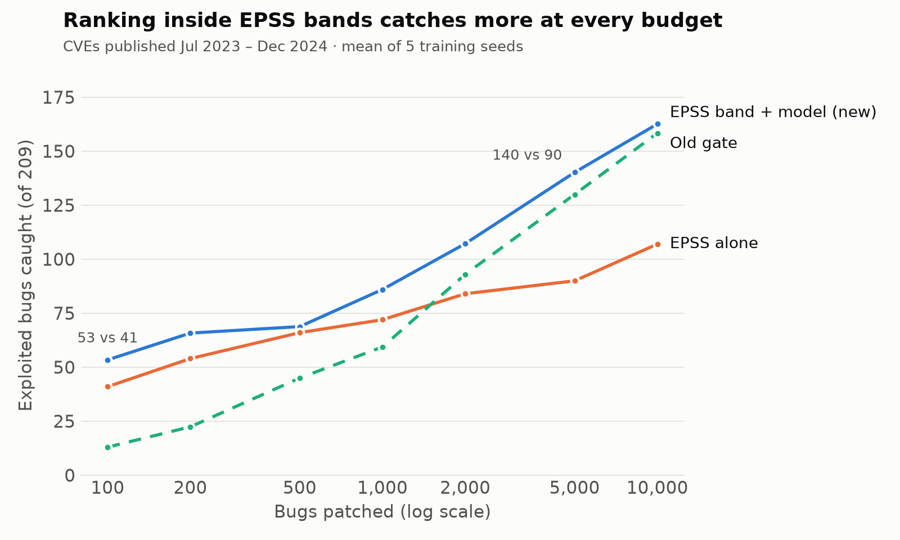
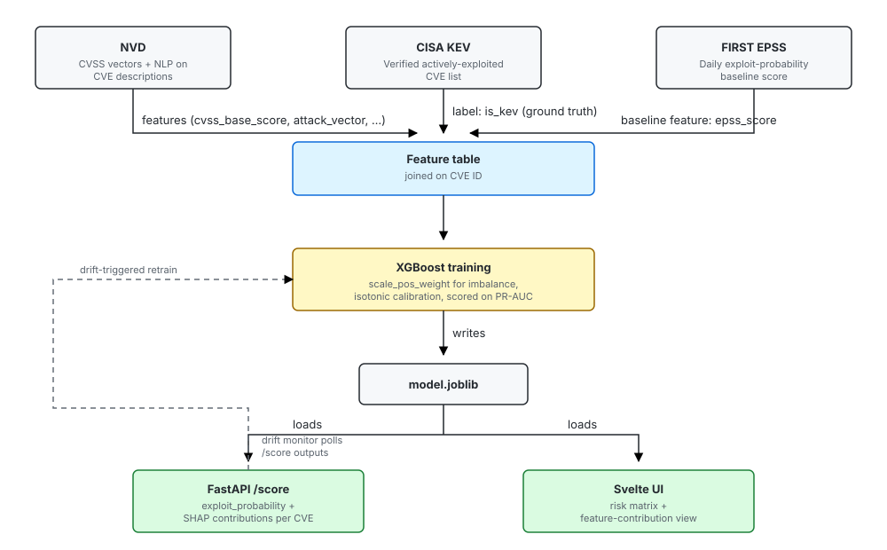

# AI-Assisted Vulnerability Risk Prioritization

Predictive probability model for vulnerability triage — replaces static CVSS severity heuristics with a calibrated `P(Exploit | Features)` estimate.

See [`PROJECT_PLAN.md`](./PROJECT_PLAN.md) for the problem statement, architecture, and roadmap, and [`DATA_SOURCES.md`](./DATA_SOURCES.md) for the three data sources (NVD, CISA KEV, FIRST EPSS) and how they join.

## Current result

Read [`FINDINGS.md`](./FINDINGS.md) before quoting any number from this repo.

Evaluated point-in-time — EPSS read from the dated archive snapshot for
publication + 1 day, never a current pull — against a bounded target (added to
CISA KEV within 365 days of publication). CVEs published 2023-07 → 2024-12,
54,290 rows, 209 positives, base rate 0.385%.

| ranker | PR-AUC | P@100 |
|---|---|---|
| CVSS base score | 0.0120 | 0.050 |
| EPSS (point-in-time) | 0.1753 | 0.410 |
| XGB (no EPSS) | 0.0457 | — |
| rank blend, weight chosen on validation | 0.0457 | 0.112 |
| **banded: EPSS band, content orders within** | **0.2421 ± 0.0008** | **0.534** |

**EPSS picks the band, the content model orders inside it.** Read one day after
publication, EPSS is a small, sharp instrument: its power is the separation
*between* its score bands (base rate 0.26% → 10% → 76%), and it barely orders
*within* them (0.89–3.32x lift). The content model is the mirror image, at up to
12.8x lift inside a band. So keep every EPSS decade band (0.001 / 0.01 / 0.1)
and let the content model order only inside each:

| budget | EPSS | banded | seeds ≥ EPSS | recall |
|---|---|---|---|---|
| 100 | 41 | **53.4 ± 1.0** | 5/5 | 19.6% → 25.8% |
| 1,000 | 72 | **86.0 ± 1.8** | 5/5 | 34.4% → 41.6% |
| 5,000 | 90 | **140.2 ± 1.0** | 5/5 | 43.1% → 68.4% |
| 10,000 | 107 | **162.6 ± 2.9** | 5/5 | 51.2% → 79.9% |



It beats EPSS at every budget from 100 to 10,000 and as a global ranker
(PR-AUC +38%), in all five seeds, **with no tuned parameter** — the two earlier
attempts both failed at the step where a weight or cutoff had to be picked from
63 validation positives (§7, §9). See [`FINDINGS.md`](./FINDINGS.md) §7–10.

### Two leaks, both measured

An early run reported 0.4176 PR-AUC, from EPSS scores pulled in 2026 for CVEs
published in 2023-24 — after the exploitation they were predicting — against an
open-ended "in KEV ever" label (§1–4).

The fix for that introduced a second, smaller one: aligning EPSS to the start of
the month *after* publication bought coverage but put the snapshot a median 16
days past publication, against a median 15 days to KEV listing. **59% of
positives were scored with EPSS values read after CISA had already catalogued
them**, inflating the EPSS baseline from 0.1753 to 0.2701 (§6). Daily alignment
brings contamination to the floor the catalogue itself sets.

`src/schema.py:validate()` now runs on every point-in-time load and refuses both
mistakes — it previously had no call sites at all.

## Architecture



## Layout

```
src/
  schema.py      # data contract; marks each column point-in-time-safe or snapshot-only
  ingestion/     # NVD, CISA KEV, FIRST EPSS clients
    epss_history.py  # dated EPSS archive snapshots (the leakage fix)
    prefetch_daily.py   # warms the ~1,300-file daily snapshot cache
  features/      # joins the three sources into a training table
  model/
    dataset.py       # THE validated loader — attaches dated EPSS, runs schema.validate
    evaluate.py      # original temporal evaluation (deliberately leaked baseline)
    evaluate_pit.py  # point-in-time re-evaluation
    verify.py        # split / seed / calibration checks
    verify_pit_lag.py   # measures snapshot-vs-KEV-listing contamination
    blend.py         # rank-blend vs EPSS; weight chosen on validation
    complementarity.py  # per-EPSS-band: where does content add signal?
    two_stage.py     # gated + banded policies — EPSS band first, content within
  api/           # FastAPI inference endpoint with SHAP explanations
data/
  raw/           # pulled API responses + cached EPSS snapshots, untouched
  processed/     # joined feature tables (parquet)
notebooks/       # exploratory analysis
tests/           # python -m tests.test_ranking / tests.test_schema_gate
```

## Quick start

```bash
pip install -r requirements.txt
python -m src.ingestion.nvd_client   # sanity-check NVD access
python -m src.ingestion.kev_client   # sanity-check CISA KEV feed
python -m src.ingestion.epss_client  # sanity-check FIRST EPSS API

python -m src.ingestion.prefetch_daily   # ~1,300 daily EPSS snapshots (~1.6 GB, once)
python -m src.model.two_stage            # gated + banded policy results
python -m src.model.plot_two_stage       # docs/banded-vs-epss.png (needs matplotlib)
python -m tests.test_ranking && python -m tests.test_schema_gate
```
