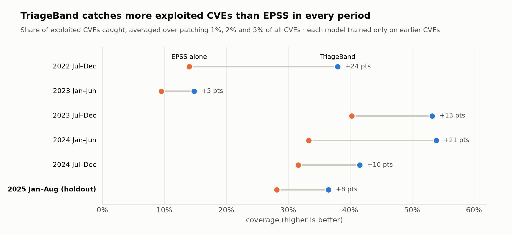
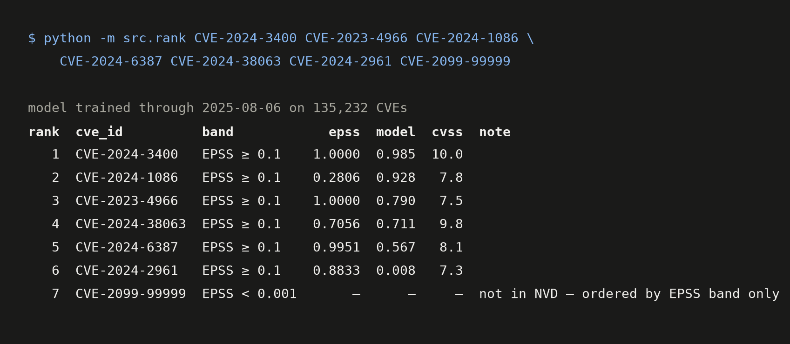

# AI-Assisted Vulnerability Risk Prioritization

Predictive probability model for vulnerability triage — replaces static CVSS severity heuristics with a calibrated `P(Exploit | Features)` estimate.

See [`PROJECT_PLAN.md`](./PROJECT_PLAN.md) for the problem statement, architecture, and roadmap, and [`DATA_SOURCES.md`](./DATA_SOURCES.md) for the three data sources (NVD, CISA KEV, FIRST EPSS) and how they join.

## Current result

Read [`FINDINGS.md`](./FINDINGS.md) before quoting any number from this repo.

Evaluated point-in-time — EPSS read from the dated archive snapshot for
publication + 1 day, never a current pull — against a bounded target (added to
CISA KEV within 365 days of publication). CVEs published 2023-07 → 2024-12,
54,290 rows, 209 positives, base rate 0.385%.

| ranker | PR-AUC | P@100 |
|---|---|---|
| CVSS base score | 0.0120 | 0.050 |
| EPSS (point-in-time) | 0.1753 | 0.410 |
| XGB (no EPSS) | 0.0457 | — |
| rank blend, weight chosen on validation | 0.0457 | 0.112 |
| **banded: EPSS band, content orders within** | **0.2484 ± 0.0017** | **0.520** |

**EPSS picks the band, the content model orders inside it.** Read one day after
publication, EPSS is a small, sharp instrument: its power is the separation
*between* its score bands (base rate 0.26% → 10% → 76%), and it barely orders
*within* them (0.89–3.32x lift). The content model is the mirror image, at up to
12.8x lift inside a band. So keep every EPSS decade band (0.001 / 0.01 / 0.1)
and let the content model order only inside each:

| budget | EPSS | banded | gain, 95% bootstrap CI | recall |
|---|---|---|---|---|
| 100 | 41 | **52.0** | +11 [+2, +21] | 19.6% → 24.9% |
| 1,000 | 72 | **92.8** | +21 [+12, +32] | 34.4% → 44.4% |
| 5,000 | 90 | **140.2** | +51 [+34, +68] | 43.1% → 67.1% |
| 10,000 | 107 | **162.8** | +56 [+38, +74] | 51.2% → 77.9% |

The content model here uses only fields fixed at publication. The CPE-derived
features (`vendor`, `n_vendors`, `n_cpe`) turned out to be a third leak — NVD
adds them during analysis, and through its 2024-25 backlog analysed KEV CVEs
first — so they are excluded (§11). Dropping them did not lower the result.


It beats EPSS at every budget from 100 to 10,000 and as a global ranker
(PR-AUC +42%), **with no tuned parameter** — the two earlier attempts both failed
at the step where a weight or cutoff had to be picked from 63 validation
positives (§7, §9).

**Verified out of sample** (`python -m src.model.verify_banded`, §11): across six
rolling 6-month windows, each trained only on earlier CVEs, it matches or beats
EPSS at every budget in 18/18 window-seeds and improves PR-AUC in all six. On a
2025 holdout no design decision was made from, PR-AUC rises 0.073 → 0.113
(+55%, 95% CI of gain [+0.016, +0.071]). Shuffling the model's scores within
bands drops it below EPSS, so the gain is the model's, not the bands'. Ordering
within bands by CVSS instead loses to EPSS, so the model is needed. See
[`FINDINGS.md`](./FINDINGS.md) §7–11.



### Three leaks, all measured

An early run reported 0.4176 PR-AUC, from EPSS scores pulled in 2026 for CVEs
published in 2023-24 — after the exploitation they were predicting — against an
open-ended "in KEV ever" label (§1–4).

The fix for that introduced a second, smaller one: aligning EPSS to the start of
the month *after* publication bought coverage but put the snapshot a median 16
days past publication, against a median 15 days to KEV listing. **59% of
positives were scored with EPSS values read after CISA had already catalogued
them**, inflating the EPSS baseline from 0.1753 to 0.2701 (§6). Daily alignment
brings contamination to the floor the catalogue itself sets.

`src/schema.py:validate()` now runs on every point-in-time load and refuses both
mistakes — it previously had no call sites at all.

The third was in the content features. `vendor`, `n_vendors` and `n_cpe` come
from NVD's CPE list, added during NVD analysis after publication. Through the
2024-25 backlog NVD analysed KEV CVEs first, so **18.9% of unexploited 2024 CVEs
(32.2% in 2025) have no CPE data, against 0% of exploited ones** — "never
analysed" meant "not in KEV". The schema now marks these `ENRICHED`, not
point-in-time-safe, and the headline model excludes them (§11).

## Using it

```bash
python -m src.model.train        # fit the verified model → models/banded.joblib (~135k CVEs)
python -m src.rank CVE-2024-3400 CVE-2023-4966 CVE-2024-1086
python -m src.rank --file scan_cves.txt --top 50 --csv ranked.csv
uvicorn src.api.main:app         # POST /rank {"cve_ids": [...]}, GET /health
```



Each CVE gets today's EPSS and its NVD record (description, CVSS, CWE — never
CPE). EPSS sets the band; the model orders within it. CVEs with no EPSS yet join
the bottom band; CVEs NVD does not know rank last in their band and are flagged.
NVD's public limit is 5 requests / 30 s — set `NVD_API_KEY` for large scans.

## Architecture


## Layout

```
src/
  schema.py      # data contract; marks each column point-in-time-safe or snapshot-only
  ingestion/     # NVD, CISA KEV, FIRST EPSS clients
    epss_history.py  # dated EPSS archive snapshots (the leakage fix)
    prefetch_daily.py   # warms the ~1,300-file daily snapshot cache
  features/      # joins the three sources into a training table
  model/
    train.py         # fits the deployable model bundle (encoders + 5 seeds)
    dataset.py       # THE validated loader — attaches dated EPSS, runs schema.validate
    evaluate.py      # original temporal evaluation (deliberately leaked baseline)
    evaluate_pit.py  # point-in-time re-evaluation
    verify.py        # split / seed / calibration checks
    verify_pit_lag.py   # measures snapshot-vs-KEV-listing contamination
    blend.py         # rank-blend vs EPSS; weight chosen on validation
    complementarity.py  # per-EPSS-band: where does content add signal?
    two_stage.py     # gated + banded policies — EPSS band first, content within
    verify_banded.py # leak audit, ablation, bootstrap, permutation null, rolling + 2025 holdout
  api/           # FastAPI /rank endpoint over src/rank.py
rank.py          # CVE IDs → banded patch ranking (CLI + function)
data/
  raw/           # pulled API responses + cached EPSS snapshots, untouched
  processed/     # joined feature tables (parquet)
notebooks/       # exploratory analysis
tests/           # python -m tests.test_ranking / tests.test_schema_gate
```

## Quick start

```bash
pip install -r requirements.txt
python -m src.ingestion.nvd_client   # sanity-check NVD access
python -m src.ingestion.kev_client   # sanity-check CISA KEV feed
python -m src.ingestion.epss_client  # sanity-check FIRST EPSS API

python -m src.ingestion.prefetch_daily --end 2025-08-06   # ~1,530 daily EPSS snapshots (once)
python -m src.model.two_stage            # gated + banded policy results
python -m src.model.verify_banded        # tries to break the banded result (§11)
python -m src.model.plot_two_stage       # docs/banded-vs-epss.png (needs matplotlib)
python -m tests.test_ranking && python -m tests.test_schema_gate
```
