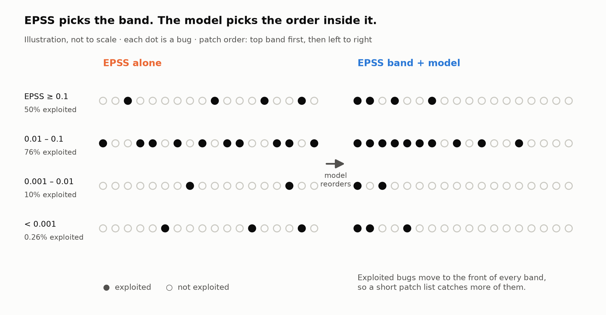

# TriageBand

**Patch the vulnerabilities attackers will actually use, first.** TriageBand
ranks CVEs for remediation by keeping EPSS's risk bands and ordering the CVEs
inside each band with a gradient-boosted model trained only on what is known the
day after a CVE is published — its NVD description, CVSS vector, weakness type,
and whether public exploit code has appeared. Every ranked CVE comes with the
reasons behind its position.

New to the field? Start with [`BACKGROUND.md`](./BACKGROUND.md): the problem,
why it matters, and every term used here.

## Result

Tested on CVEs published January–August 2025 — a period no modelling decision
was based on — with the model trained only on earlier CVEs. 26,862 CVEs, 116
exploited within a year (CISA KEV). Effort is the share of all CVEs patched;
coverage the share of exploited CVEs caught; efficiency the share of patches
that were exploited.

| effort | CVEs patched | EPSS catches | **TriageBand catches** | efficiency, EPSS → TriageBand |
|---|---|---|---|---|
| 1% | 269 | 23 (20%) | **34 (29%)** | 8.6% → 12.6% |
| 2% | 537 | 29 (25%) | **43 (37%)** | 5.4% → 8.0% |
| 5% | 1,343 | 46 (40%) | **50 (43%)** | 3.4% → 3.7% |
| 10% | 2,686 | 62 (53%) | **87 (75%)** | 2.3% → 3.2% |

**To catch half of the exploited CVEs, TriageBand needs 1,564 patches; EPSS
alone needs 1,907 — 18% less work.** The same holds across all six 6-month
windows from 2022 to 2025:


TriageBand complements EPSS rather than replacing it: EPSS decides the band.
Details, every variant tried, and what did not work are in
[`FINDINGS.md`](./FINDINGS.md) §10–12.

## How it works



1. **EPSS picks the band** — decade bands at 0.001, 0.01 and 0.1. A higher band
   always comes first. EPSS is excellent at this: the exploited rate climbs from
   0.26% to 10% to 76% across bands.
2. **The model picks the order inside each band**, where EPSS's own ordering is
   close to random. Inputs: NVD description (TF-IDF), CVSS vector, CWE, and
   GitHub / Exploit-DB / Metasploit exploit counts, all as of publication + 1 day.
3. **Nothing is tuned on scarce data.** The band edges are fixed; the model is an
   XGBoost ensemble of five seeds.
4. **Every CVE is explained** — the three strongest present reasons from exact
   per-CVE SHAP values, e.g. *description mentions "unauthenticated"; CVSS base
   score 10.0*.

## How the evaluation stays honest

Four mistakes would each have inflated the result; all are measured and closed.

An early run reported 0.4176 PR-AUC, from EPSS scores pulled in 2026 for CVEs
published in 2023-24 — after the exploitation they were predicting — against an
open-ended "in KEV ever" label (§1–4).

The fix for that introduced a second, smaller one: aligning EPSS to the start of
the month *after* publication bought coverage but put the snapshot a median 16
days past publication, against a median 15 days to KEV listing. **59% of
positives were scored with EPSS values read after CISA had already catalogued
them**, inflating the EPSS baseline from 0.1753 to 0.2701 (§6). Daily alignment
brings contamination to the floor the catalogue itself sets.

`src/schema.py:validate()` now runs on every point-in-time load and refuses both
mistakes — it previously had no call sites at all.

The third was in the content features. `vendor`, `n_vendors` and `n_cpe` come
from NVD's CPE list, added during NVD analysis after publication. Through the
2024-25 backlog NVD analysed KEV CVEs first, so **18.9% of unexploited 2024 CVEs
(32.2% in 2025) have no CPE data, against 0% of exploited ones** — "never
analysed" meant "not in KEV". The schema now marks these `ENRICHED`, not
point-in-time-safe, and the headline model excludes them (§11).

A fourth was avoided rather than found: counted from today's data, public
exploit code exists for **53%** of exploited CVEs; counted as of the day after
publication, as TriageBand does, it is **14%** (§12).

## Using it

```bash
python -m src.model.train        # fit TriageBand → models/banded.joblib (~135k CVEs)
python -m src.rank CVE-2024-3400 CVE-2023-4966 CVE-2024-1086
python -m src.rank --file scan_cves.txt --top 50 --csv ranked.csv
uvicorn src.api.main:app         # POST /rank {"cve_ids": [...]}, GET /health
```


Each CVE gets today's EPSS and its NVD record (description, CVSS, CWE — never
CPE). EPSS sets the band; the model orders within it. CVEs with no EPSS yet join
the bottom band; CVEs NVD does not know rank last in their band and are flagged.
NVD's public limit is 5 requests / 30 s — set `NVD_API_KEY` for large scans.
Exploit counts come from local copies of Exploit-DB and PoC-in-GitHub; download
commands are at the top of `src/features/exploit_features.py`.

## Architecture


## Layout

```
src/
  schema.py      # data contract; marks each column point-in-time-safe or snapshot-only
  ingestion/     # NVD, CISA KEV, FIRST EPSS clients
    epss_history.py  # dated EPSS archive snapshots (the leakage fix)
    prefetch_daily.py   # warms the ~1,300-file daily snapshot cache
  features/      # joins the sources into a training table
    exploit_features.py # Exploit-DB / PoC-in-GitHub counts as of a date
  model/
    train.py         # fits the deployable model bundle (encoders + 5 seeds)
    dataset.py       # THE validated loader — attaches dated EPSS, runs schema.validate
    evaluate.py      # original temporal evaluation (deliberately leaked baseline)
    evaluate_pit.py  # point-in-time re-evaluation
    verify.py        # split / seed / calibration checks
    verify_pit_lag.py   # measures snapshot-vs-KEV-listing contamination
    blend.py         # rank-blend vs EPSS; weight chosen on validation
    complementarity.py  # per-EPSS-band: where does content add signal?
    two_stage.py     # gated + banded policies — EPSS band first, content within
    compare.py       # TriageBand variants on coverage / efficiency (§12)
    metrics.py       # coverage, efficiency, effort-to-coverage, calibration
    explain.py       # per-CVE reason codes from exact SHAP values
    verify_banded.py # leak audit, ablation, bootstrap, permutation null, rolling + 2025 holdout
  api/           # FastAPI /rank endpoint over src/rank.py
rank.py          # CVE IDs → banded patch ranking (CLI + function)
data/
  raw/           # pulled API responses + cached EPSS snapshots, untouched
  processed/     # joined feature tables (parquet)
notebooks/       # exploratory analysis
tests/           # python -m tests.test_ranking / tests.test_schema_gate
```

## Quick start

```bash
pip install -r requirements.txt
python -m src.ingestion.nvd_client   # sanity-check NVD access
python -m src.ingestion.kev_client   # sanity-check CISA KEV feed
python -m src.ingestion.epss_client  # sanity-check FIRST EPSS API

python -m src.ingestion.prefetch_daily --end 2025-08-06   # ~1,530 daily EPSS snapshots (once)
python -m src.model.two_stage            # gated + banded policy results
python -m src.model.verify_banded        # tries to break the banded result (§11)
python -m src.model.plot_two_stage       # docs/banded-vs-epss.png (needs matplotlib)
python -m tests.test_ranking && python -m tests.test_schema_gate
```
